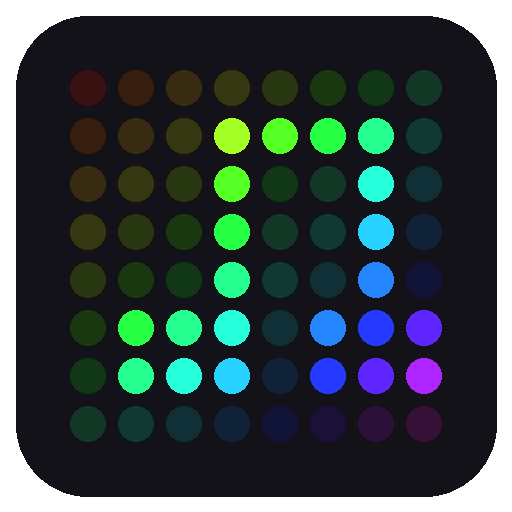

<div align="center">
  

  <h1>Pixel Jukebox</h1>

  <p>A 64x64 LED matrix that shuffles through pixel art from <a href="https://makapix.club">Makapix Club</a>:<br><strong>plug it in, enter a code, and it plays.</strong></p>

  <p>
    
    
    
    
    
  </p>
</div>

<!-- Photo of the panel playing artwork goes here:
<p align="center">
  
</p>
-->

---

## What it is

Pixel Jukebox is firmware for a Waveshare ESP32-S3 driver board and a 64x64 HUB75 LED panel. It registers itself as a player on Makapix Club, a pixel art community, then pulls artwork from the public feed and shows each piece for about 30 seconds, like a jukebox working through a stack of records.

There is no app and no server of your own to run. The board talks to Makapix directly over Wi-Fi and remembers its registration across restarts.

## Features

| Area | What's included |
|---|---|
| **Slots** | Rotates through screens: by default three artworks, then a clock for 10 seconds. The rotation is editable from the control page and saved on the board |
| **Button** | BOOT button: short press skips to the next slot, long press holds the current one |
| **Control page** | Open `http://pixel-jukebox.local` on a phone or PC: see the artwork and artist, skip, hold, set brightness |
| **REST API** | Status, skip, hold and brightness over HTTP, found on the network as `pixel-jukebox.local` |
| **Registration** | Shows a 6-character code on the panel; enter it on makapix.club and the board stores its token |
| **Artwork feed** | Shuffles every post that is 64 pixels or smaller and has a GIF rendition, 25 at a time |
| **Playback** | Animated and still GIFs, each shown for its dwell time, finishing the loop in progress |
| **Scaling** | 16x16 and 32x32 art is scaled by a whole number and centred, so pixels stay sharp |
| **Preloading** | The next artwork downloads in the background while the current one plays |
| **Recovery** | Re-registers if the device is removed on the site; reconnects after a Wi-Fi drop; skips bad files |
| **Security** | Verifies the makapix.club TLS certificate before sending the device token |
| **Diagnostics** | Separate builds for a colour and power check and a speaker test |

## Hardware

| Part | Notes |
|---|---|
| Waveshare ESP32-S3-RGB-Matrix | Driver board; ESP32-S3 with 32 MB octal flash and 16 MB octal PSRAM |
| Waveshare RGB-Matrix-P2-64x64 | HUB75 panel, 2 mm pitch, 1/32 scan |
| 5V supply | Waveshare advises 4 A per panel; over the board's USB-C power port, white tints above brightness 32 |

Pin mapping is in [`include/pins.h`](include/pins.h).

## Stack

| Layer | Technology |
|---|---|
| Build | PlatformIO, Arduino framework (arduino-esp32 2.x) |
| Display | ESP32-HUB75-MatrixPanel-DMA, Adafruit GFX |
| Artwork | AnimatedGIF, decoded from RAM (PSRAM) |
| Network | Makapix player API over HTTPS, ArduinoJson; images over plain HTTP from the vault |
| Remote control | Built-in WebServer and mDNS, JSON over HTTP |
| Storage | NVS (Preferences) for the player key, token and brightness |
| Audio | ES8311 codec over I2C and I2S (test build only so far) |

## Getting started

**Prerequisites:** VS Code with the PlatformIO extension, and a [Makapix Club](https://makapix.club) account

```sh
git clone https://github.com/billydavis/pixel-jukebox.git
cd pixel-jukebox
cp include/secrets.example.h include/secrets.h   # then fill in your 2.4 GHz Wi-Fi
pio run -t upload
```

On first boot the panel shows a 6-character code. Enter it at makapix.club under **Settings > Players > Add Device**. The board shows "linked!" and starts playing.

### Uploading

The board has two USB-C ports: **Power** feeds the board and the panel, **USB** carries data to the PC.

If an upload fails with "No serial data received", unplug both cables, hold **BOOT**, plug the **USB** cable back in, release **BOOT**, then upload again.

### Time zone

The clock's time zone is `TIMEZONE` in [`include/config.h`](include/config.h) (US Central by default).

### Brightness

Brightness (0-255) is set through the API and remembered across restarts; the starting value is `DEFAULT_BRIGHTNESS` in [`src/display.cpp`](src/display.cpp). Raise it only as far as white stays white; see the colour check below.

## Control page

Open `http://pixel-jukebox.local` (or the board's IP address) in a browser on the same network. The page shows what is on the panel and who made it, with Hold, Next and a brightness slider, and a Rotation section for choosing which slots play and for how long. On a keyboard, `N` skips and `H` holds. It is a single file built into the firmware, with no external assets.

## REST API

The board serves a small JSON API for remote control, at `http://pixel-jukebox.local/api/v1`. The full contract is in [`docs/jukebox-api.md`](docs/jukebox-api.md).

```sh
curl http://pixel-jukebox.local/api/v1/status
curl -X POST http://pixel-jukebox.local/api/v1/next
```

A Postman collection is in [`postman/`](postman/Pixel-Jukebox-API.postman_collection.json); set its `device_ip` variable to the board's address.

There is no authentication: anyone on the same network can call it.

## Diagnostic builds

Two extra PlatformIO environments run a check at boot and then carry on as normal. Upload the regular firmware again afterwards.

```sh
pio run -e colour-check -t upload
```

Shows white at brightness 32, 64 and 128, then colour bars. If white turns yellow or red as the brightness rises, the 5V supply is sagging: lower the brightness or use a stronger supply.

```sh
pio run -e speaker-test -t upload
```

Lists the devices on the I2C bus, then plays a chime and a steady tone three times.

## Makapix API script

[`tools/makapix_player.py`](tools/makapix_player.py) walks the same player API from a PC, using only the Python standard library. It is useful for trying queries before changing the firmware.

```sh
python tools/makapix_player.py                 # register (first run), query, download
python tools/makapix_player.py --channel hashtag --hashtag landscape --download 5
python tools/makapix_player.py --reset         # forget the stored player
```

The first run registers a second player on your account. Its key and token are kept in `tools/.player_state.json`, and downloads go to `tools/downloads/`; both are git-ignored.

## Development

| Path | Purpose |
|---|---|
| `src/main.cpp` | Wi-Fi, running each slot and command handling |
| `src/rotation.cpp` | The slot types and the saved rotation |
| `src/slot.h` | Interface every slot implements |
| `src/slot_makapix.cpp` | Artwork slot: registration, background loader, playback |
| `src/slot_clock.cpp` | Clock slot (network time) |
| `src/commands.cpp` | Command queue and the BOOT button |
| `src/api.cpp` | HTTP server and mDNS |
| `src/web_page.h` | The control page (HTML, CSS and JavaScript in one string) |
| `src/status.cpp` | Shared "now showing" state read by the API |
| `src/makapix.cpp` | Makapix player API and stored credentials |
| `src/gif_player.cpp` | GIF download and frame-by-frame playback, with whole-number scaling |
| `src/display.cpp` | Panel setup, text screens, colour check |
| `src/audio.cpp` | Speaker output through the ES8311 codec |
| `include/pins.h` | HUB75, I2C and audio GPIO mapping, panel size |
| `include/ca_certs.h` | Root certificates trusted for makapix.club |
| `include/secrets.example.h` | Wi-Fi credentials template |

```sh
pio run                 # build
pio run -t upload       # build and flash
pio device monitor      # serial log at 115200 baud
```

## Roadmap

Working today: registration, shuffled playback with preloading, a slot rotation with a clock, button, web and REST control, certificate checking, and the diagnostic builds.

Ideas for later:

- Power the panel from the dedicated 5V input for full brightness
- Report views, and MQTT for "send to device" commands from the Makapix site
- Brightness control and a Wi-Fi setup portal
- Use the speaker, microphones and onboard sensors
- More of the API: show a specific post, sensors, per-slot settings
- A companion app (Flutter)

Ideas borrowed from [Pixelix](https://github.com/BlueAndi/Pixelix), using parts already on the board:

- More slot types
- Keep time across restarts with the onboard clock chip
- Room temperature and humidity (onboard sensor), and a weather screen
- Sound-reactive spectrum display (onboard microphones)
- Built-in effects such as fire, falling code, rainbow and Game of Life
- A web page for settings, and firmware updates over Wi-Fi

## Acknowledgements

Pixel Jukebox is inspired by [Pixelix](https://github.com/BlueAndi/Pixelix) by BlueAndi, a far more complete LED matrix firmware with a plugin system, web interface and its own Makapix player. Seeing Makapix art on a Pixelix display is what started this project. Pixel Jukebox is written from scratch as a learning project and shares no code with Pixelix.

Thanks also to [Makapix Club](https://makapix.club) for the open player API and its documentation, and to the authors of the libraries listed under Stack.

## License

MIT License. See [LICENSE](LICENSE) for details.
